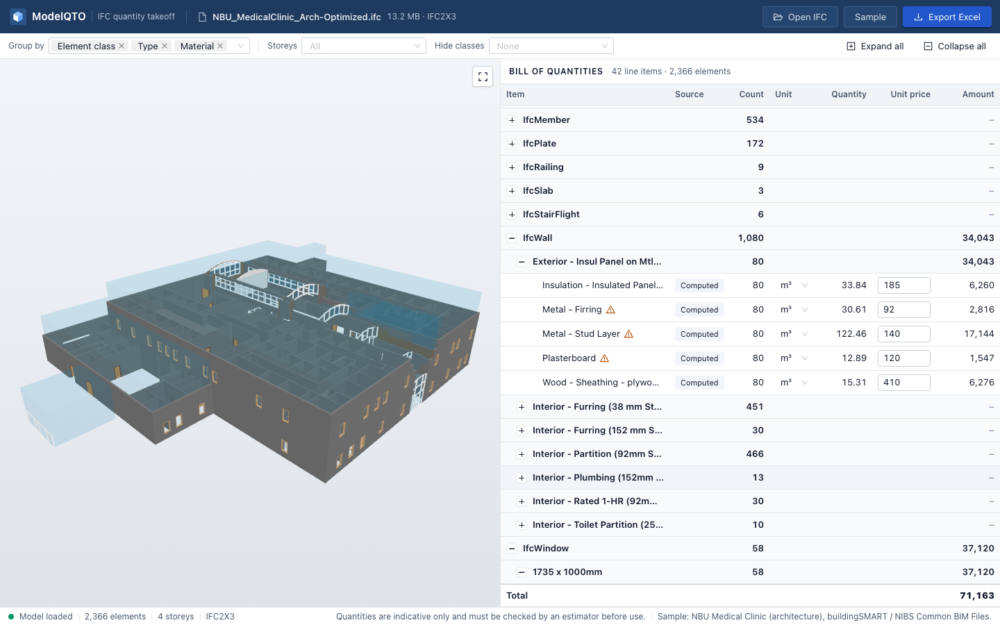
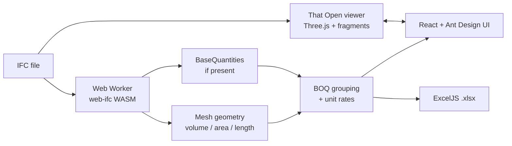

# ModelQTO — IFC quantity takeoff in the browser

Drop an IFC file into the page and get a 3D view plus a bill of quantities (BOQ). You can add unit rates and export the BOQ to Excel. Everything runs on your machine: there's no backend, no login, and the model is never uploaded.



## Features

- **Open IFC2x3 / IFC4** by drag-and-drop or file picker (up to ~200 MB), or load the built-in sample.
- **Automatic BOQ** grouped by element class → type → material, with count, length (m), area (m²) and volume (m³).
- **Source on every row**: `Qto` when the number comes from the file's BaseQuantities, `Computed` when it's measured from geometry, so you know which rows to double-check.
- **3D ↔ BOQ linking**: click a row to highlight its elements, or click an element to find its row.
- **Filter and regroup**: filter by storey, hide element classes, and change the grouping order (e.g. storey → class, material → class).
- **Unit rates**: enter a rate and pick the unit (each / m / m² / m³) on each row to get line totals and a grand total.
- **Excel export** (`.xlsx`): keeps the grouping, rates and source column. Line totals are Excel formulas, not hard-coded values.

## How it works



- Quantities come from the file's `Qto_*BaseQuantities` first. If an element has none, they're computed from its mesh: volume from signed tetrahedra, area from the dominant faces, length from an oriented bounding box.
- Only leaf elements are counted, so assemblies and their parts aren't double-counted. Layered materials are split into separate rows.
- Units are converted to metric using the file's `IfcUnitAssignment`.

## Run locally

```bash
npm install        # also copies web-ifc.wasm + fragments worker into public/vendor
npm run dev        # http://localhost:5173
npm run build      # type-check + production build into dist/
```

## Tests

```bash
npm test           # Vitest unit tests (core extraction, QTO, BOQ, Excel export)
npm run e2e        # Playwright smoke, screenshot and perf specs
```

## Stack

React 19 · TypeScript · Vite · Ant Design · That Open Components v3 · Three.js · web-ifc · ExcelJS · Vitest · Playwright

## Known limitations

- Quantities are meant for early estimates. An estimator should check them before using them.
- Computed volumes depend on how clean the mesh is. Some Revit exports have flipped normals or open meshes, which give negative volumes. In the NBU sample this mostly affects `IfcCovering` and stringer `IfcMember` rows.
- No detailed MEP (pipes, ducts, cables) or rebar. No `.rvt` / PDF / DWG input.
- Desktop browsers (latest Chrome or Edge). On mobile the layout works, but the app isn't optimized for it.

## Sample files

- `public/samples/NBU_MedicalClinic_Arch-Optimized.ifc`: NBU Medical Clinic (architecture), buildingSMART / NIBS Common BIM Files.
- `public/samples/office_str.ifc`: office building (structure), VTT, CC BY-SA 4.0.

The sample files belong to their original authors and keep their original licenses.
