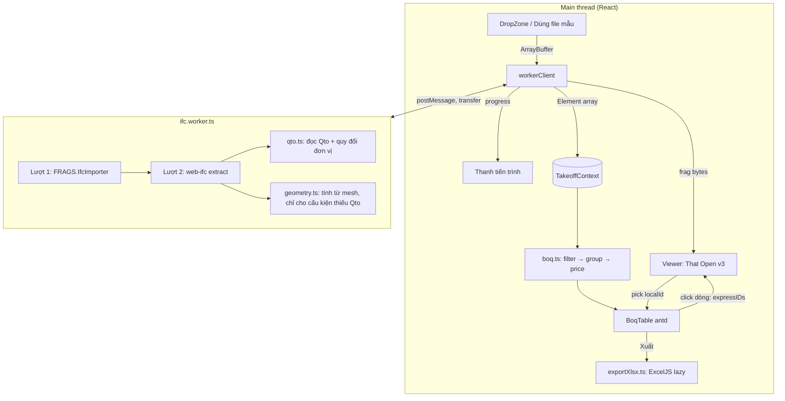

# System Design & Architecture

Feature: `ifc-quantity-takeoff`. Design review: 2026-10-24. Requirements: `docs/ai/requirements/2026-10-07-feature-ifc-quantity-takeoff.md`.

## Architecture Overview

**What is the high-level system structure?**

Ứng dụng tĩnh, chạy 100% trên trình duyệt. File IFC chỉ được đọc vào bộ nhớ, không gửi qua mạng. Một Web Worker làm hai lượt xử lý tuần tự trên cùng mảng byte:

1. **Lượt hiển thị:** `FRAGS.IfcImporter` chuyển IFC → fragments để xem 3D.
2. **Lượt khối lượng:** web-ifc mở lại file, sinh ra `Element[]` dạng JSON thuần.

Main thread chỉ làm ba việc: nhóm và tính tiền (hàm thuần), vẽ bảng, và điều khiển viewer.



**Công nghệ** (giữ cùng phiên bản với `~/clone-viewer` để dùng lại code đã chạy được)

| Mảng | Chọn | Lý do |
|---|---|---|
| Build | Vite + React 19 + TypeScript | Giống clone-viewer |
| 3D | `@thatopen/components` / `components-front` / `fragments` ~3.4, `three` 0.186 | Có sẵn tô sáng (Highlighter), raycast, stream/cull để chịu được file 150MB. Copy `engine.ts` và `ifc.worker.ts` từ clone-viewer |
| Đọc IFC | `web-ifc` ghim bản 0.0.77 | Trùng bản mà fragments dùng, nên chỉ cần một file WASM |
| UI | antd 6 (Table dạng cây, InputNumber, Select) | Bảng BOQ có nhóm lồng nhau và ô nhập số được antd làm sẵn |
| Excel | `exceljs`, chỉ `import()` khi bấm Xuất | Ghi được công thức, style và outline nhóm. Không làm nặng lần tải đầu |
| Test | vitest (unit + chạy extract trên file IFC mẫu), Playwright cho smoke test | |
| Host | Cloudflare Pages (tĩnh) | Chi phí 0. Giới hạn 25MB mỗi file, nên file mẫu cần nhỏ |

## Data Models

**What data do we need to manage?**

```ts
type QtySource = 'qto' | 'geometry';

/** Một cấu kiện lá × một vật liệu. Worker sinh ra, sau đó không đổi. Mọi số đã quy về hệ mét. */
interface Element {
  expressId: number;            // = localId của fragments (sẽ kiểm chứng ở spike S1)
  globalId: string;
  ifcClass: string;             // 'IfcWall', 'IfcSlab'… (IfcWallStandardCase gộp vào IfcWall)
  typeName: string;             // tên IfcTypeObject, không có thì '(Không xác định)'
  material: string;             // tên lớp/vật liệu, không có thì '(Không xác định)'
  storey: string;               // IfcBuildingStorey chứa nó, không có thì '(Không xác định)'
  parent?: string;              // tên cấu kiện cha qua IfcRelAggregates (để biết thuộc assembly nào)
  length?: number;  area?: number;  volume?: number;   // m, m², m³
  source: Record<'length' | 'area' | 'volume', QtySource | undefined>;
  warnings: string[];           // 'mesh-invalid', 'no-geometry', 'layer-split'
  // Không có trường count: BOQ đếm số expressId khác nhau (sửa 2026-10-24 khi implement)
}

type Unit = 'count' | 'm' | 'm2' | 'm3';

/** Khóa định giá: không phụ thuộc cách nhóm hay bộ lọc tầng. */
type PriceKey = `${string}|${string}|${string}`;          // ifcClass|typeName|material
interface PriceEntry { unit: Unit; unitPrice: number }     // unitPrice >= 0

interface TakeoffState {
  fileName: string;
  elements: Element[];
  prices: Record<PriceKey, PriceEntry>;
  groupBy: GroupField[];        // mặc định ['ifcClass', 'typeName', 'material']
  storeyFilter: string[];       // rỗng = tất cả các tầng
  hiddenClasses: string[];      // ẩn/hiện theo loại cấu kiện (áp cho cả 3D lẫn BOQ)
  selection: number[];          // expressIds đang tô sáng
}
type GroupField = 'storey' | 'ifcClass' | 'typeName' | 'material';
```

**Dữ liệu suy ra (không lưu, tính lại mỗi khi state đổi)**

```ts
interface BoqRow {              // một nút trong cây bảng
  key: string;                  // đường dẫn nhóm, ví dụ 'IfcWall/Basic Wall 200/Concrete'
  label: string;
  children?: BoqRow[];
  priceKey?: PriceKey;          // chỉ có ở dòng lá
  count: number;                // số expressId khác nhau
  length: number; area: number; volume: number;
  sources: Set<QtySource>;      // trộn cả hai nguồn thì hiện 'Qto + Tính toán'
  expressIds: number[];
  amount: number;               // lá: số lượng theo đơn vị đã chọn × đơn giá. Nhóm: cộng các con
}
```

Dòng lá luôn được tách đến mức `ifcClass, typeName, material`, kể cả khi `groupBy` không có đủ ba trường đó. Nhờ vậy mỗi dòng lá luôn có đúng một `PriceKey`, và thứ tự `groupBy` chỉ quyết định các tầng nhóm phía trên.

Đơn vị mặc định của một `PriceKey`: m³ nếu có thể tích; nếu không thì m² với tấm và tường mỏng; nếu không thì m với dầm/cột/thanh; còn lại thì đếm cái. Cửa đi và cửa sổ mặc định đếm cái.

## API Design

**How do components communicate?**

Không có API bên ngoài. Giao tiếp giữa worker và main thread:

```ts
type WorkerRequest = { bytes: Uint8Array };                      // gửi bằng transfer
type WorkerResponse =
  | { type: 'progress'; stage: 'geometry' | 'quantities'; progress: number }  // 0..1
  | { type: 'fragments'; bytes: Uint8Array }                     // gửi xong lượt 1, viewer hiện model sớm
  | { type: 'elements'; elements: Element[]; schema: 'IFC2X3' | 'IFC4' | 'IFC4X3'; warnings: string[] }
  | { type: 'error'; code: 'not-ifc' | 'out-of-memory' | 'parse'; message: string };
```

Worker giữ lại một bản sao bytes cho lượt 2. Lượt 1 chỉ nhận một bản copy, vì `IfcImporter` có thể giữ hoặc transfer buffer.

**Các module hàm thuần** (không import React hay Three, test bằng vitest):

- `extract.ts`: `extractElements(api: IfcAPI, modelID): Element[]`
- `qto.ts`: `readQuantities(...)`, `unitScale(api, modelID): { length, area, volume }`
- `geometry.ts`: `meshVolume(pos, idx)`, `dominantFaceArea(pos, idx)`, `obbLength(pos)`
- `boq.ts`: `buildBoq(elements, prices, groupBy, filters): BoqRow[]`, `defaultUnit(...)`
- `exportXlsx.ts`: `exportXlsx(rows, meta): Promise<Blob>`

## Component Breakdown

**What are the major building blocks?**

| Thành phần | Trách nhiệm |
|---|---|
| `App` | Bố cục: viewer bên trái, BOQ bên phải, toolbar ở trên, footer có dòng "Số liệu mang tính tham khảo…" và credit file mẫu |
| `DropZone` | Kéo thả hoặc chọn `.ifc`, nút "Dùng file mẫu" (`/samples/office_str.ifc`), ghi rõ giới hạn khoảng 200MB |
| `workerClient.ts` | Bọc Worker thành Promise, gửi tiến trình lên, bắt lỗi worker chết vì hết bộ nhớ thì báo `out-of-memory` |
| `Viewer` | Từ clone-viewer `engine.ts`: load fragments, `highlightByID` theo `selection`, ẩn theo `hiddenClasses` và `storeyFilter`, pick ra `localId` |
| `ui/takeoff.tsx` | React context + `useReducer` (sửa 2026-10-24 theo yêu cầu người dùng; trước là store `useSyncExternalStore`) |
| `Toolbar` | Lọc tầng (multi-select), ẩn/hiện loại cấu kiện, chọn thứ tự nhóm (preset + kéo thả đơn giản), nút Xuất Excel |
| `BoqTable` | antd Table dạng cây. Các cột: Hạng mục, Nguồn, Cái, m, m², m³, Đơn vị, Đơn giá, Thành tiền. Click dòng → `selection`. Pick trong 3D → mở nhóm và cuộn tới dòng chứa cấu kiện |

### Thuật toán khối lượng

**Phạm vi cấu kiện:** IfcWall (và StandardCase), IfcSlab, IfcRoof, IfcColumn, IfcBeam, IfcMember, IfcPlate, IfcFooting, IfcPile, IfcDoor, IfcWindow, IfcStair/IfcStairFlight, IfcRamp/IfcRampFlight, IfcRailing, IfcCovering, IfcCurtainWall, IfcBuildingElementProxy. Bỏ qua MEP, IfcSpace, IfcOpeningElement và cốt thép, đúng theo non-goals.

**Chỉ đếm cấu kiện lá:** cấu kiện nào trong phạm vi mà có con qua `IfcRelAggregates` thì không tạo `Element`. Các con của nó được tạo `Element`, có `parent` = tên cha. Qto của cha bị bỏ qua, các con lấy Qto của chính mình hoặc tính từ hình học. Quy tắc này áp dụng giống nhau cho IfcElementAssembly, IfcStair, IfcCurtainWall và IfcRoof.

**Ưu tiên Qto, theo từng đại lượng:**
- Đọc `IfcElementQuantity` qua `IfcRelDefinesByProperties`. Chấp nhận pset có tên `Qto_*` (IFC4) hoặc `BaseQuantities` (IFC2x3 và Revit).
- Chọn giá trị theo loại quantity entity, theo thứ tự ưu tiên:
  - Thể tích: `NetVolume` > `GrossVolume`.
  - Diện tích: `NetSideArea` > `NetArea` > `NetSurfaceArea` > `GrossSideArea` > `GrossArea`.
  - Chiều dài: `Length`.
- Đại lượng nào thiếu thì mới tính từ hình học. Nhờ vậy một cấu kiện có thể có thể tích từ Qto nhưng chiều dài tính toán, và cột Nguồn ghi riêng cho từng đại lượng.

**Quy đổi đơn vị:** đọc `IfcUnitAssignment` (LENGTHUNIT, AREAUNIT, VOLUMEUNIT riêng từng loại), xử lý prefix SI (MILLI, CENTI…) và `IfcConversionBasedUnit` (foot, inch…) → hệ số sang m, m², m³. Chỉ nhân hệ số này vào giá trị Qto. Mesh của web-ifc vốn đã ở mét (spike S1 sẽ kiểm chứng).

**Tính từ hình học:** dùng `StreamMeshes` của web-ifc, chỉ cho các expressID còn thiếu ít nhất một đại lượng. Áp `flatTransformation` lên mesh trước khi tính.
- **Thể tích:** tổng thể tích tứ diện có dấu. Mesh web-ifc đã trừ lỗ mở (opening) nên tường có cửa tự đúng. Mesh hở hoặc thể tích ≤ 0 thì vẫn trả số nhưng thêm cảnh báo `mesh-invalid` và hiện biểu tượng ⚠ trên dòng.
- **Diện tích:** gom tam giác theo pháp tuyến. Tìm hướng `d` có tổng diện tích lớn nhất, rồi lấy tổng diện tích các tam giác có `|n·d| > 0.98`, chia 2 (vì có hai mặt). Kết quả là diện tích thực đã trừ lỗ mở. Chỉ áp cho tường, sàn, mái, tấm, ốp lát và vách kính.
- **Chiều dài:** cạnh dài nhất của OBB, với trục chính tìm bằng PCA trên các đỉnh. Chỉ áp cho dầm, cột, thanh, cọc và lan can.
- **Đếm cái:** luôn bằng 1 cho mỗi cấu kiện lá. Cách này khớp 100% với số entity.

**Tách lớp vật liệu (`IfcMaterialLayerSetUsage` / `IfcMaterialLayerSet`):**
- Mỗi lớp thành một `Element` riêng, cùng expressId.
- Thể tích của lớp = thể tích cấu kiện × (bề dày lớp / tổng bề dày). Diện tích của lớp = diện tích cấu kiện. Số cái tính bằng expressId khác nhau nên không bị đếm trùng.
- Thêm cảnh báo `layer-split` vì đây là phân bổ theo tỷ lệ bề dày, không phải hình học thật của từng lớp.
- `IfcMaterialConstituentSet`: tách như layer set nếu mọi constituent có `Fraction` hoặc `Width` (Revit ghi Width trong `IfcPhysicalComplexQuantity` cùng tên vật liệu); không thì gộp tên bằng " + ". `IfcMaterialList`, profile set: gộp tên.
- Không có vật liệu thì ghi `(Không xác định)`.

### Excel

Một sheet `BOQ`, giữ cấu trúc cây bằng outline (dòng nhóm có thể đóng/mở). Các cột: STT, Hạng mục, Nguồn, Đơn vị, Khối lượng, Đơn giá, Thành tiền.
- Thành tiền ở dòng lá = `=E*F`.
- Dòng nhóm = `=SUBTOTAL(9, …)` để không cộng trùng các tầng nhóm.
- Dòng tổng = `SUBTOTAL` toàn bảng.
- Sheet phụ `Thông tin`: tên file, schema IFC, ngày xuất và câu miễn trừ trách nhiệm.

Đơn giá bỏ trống thì ghi 0. Nhờ dùng công thức, tổng tiền trong Excel bằng tổng trên web với cùng dữ liệu đầu vào.

## Design Decisions

**Why did we choose this approach?**

| # | Quyết định (2026-10-24) | Phương án đã cân nhắc | Lý do chọn |
|---|---|---|---|
| D1 | That Open v3 để hiển thị, chọn và tô sáng | web-ifc + Three.js tự viết | Đã chạy được trong clone-viewer. Có stream/cull cho file 150MB. Tô sáng ≤200ms không cần tự viết |
| D2 | Lượt web-ifc riêng trong worker để đọc khối lượng | Đọc khối lượng từ dữ liệu fragments | Kiểm soát được đơn vị, khác biệt IFC2x3/IFC4 và tam giác của từng cấu kiện. Viết thành hàm thuần nên test được. Đổi lại tốn thêm một lần parse, phải đo ở S1 |
| D3 | Tường/sàn nhiều lớp: mỗi lớp một dòng, chia thể tích theo bề dày | Gộp làm một dòng, vật liệu = tên layer set | Estimator cần bóc riêng bê tông, vữa trát… |
| D4 | ExcelJS, chỉ tải khi bấm Xuất | SheetJS CE | Cần cả công thức lẫn style và outline. Bản CE không ghi được style |
| D5 | Tính từ hình học dùng mesh: thể tích tứ diện, diện tích theo mặt chính, chiều dài theo OBB | Đọc tham số extrusion | Chạy được với mọi loại hình học, và tự trừ lỗ mở |
| D6 | Chỉ đếm cấu kiện lá | Chỉ đếm cấu kiện cha | Một quy tắc duy nhất, không đếm trùng, giữ được chi tiết vật liệu |
| D7 | Đơn giá gắn theo `ifcClass + type + material` | Gắn theo từng dòng đang hiển thị | Không mất giá khi đổi cách nhóm hoặc lọc tầng |
| D8 | File mẫu `office_str.ifc` (3MB, VTT, CC BY-SA 4.0, ghi credit trên trang) | Có menu nhiều file mẫu | Mở ngay, nằm trong giới hạn host. Các file lớn chỉ dùng để benchmark |

**Giả định đã đặt tên** (kiểm chứng trong spike S1 trước khi code tính năng):

- **DA1:** `localId` của fragments = expressID của IFC (clone-viewer đang ngầm dựa vào điều này).
- **DA2:** Mesh của web-ifc 0.0.77 đã ở mét và đã trừ opening cho tường, sàn.
- **DA3:** Hai lượt parse tuần tự với file 150MB không làm tab crash. Nếu crash: cho lượt 2 chạy trước rồi giải phóng, hoặc với file trên 100MB thì chỉ tính khối lượng mà không stream mesh.
- **DA4:** Dùng UI antd + store pattern của clone-viewer, không cần router.

**Subtract-before-add:** không có backend, không router, không lưu trữ, không i18n framework (chỉ tiếng Anh, `ui/strings.ts`, quyết định 2026-10-24), không tự viết engine 3D.

## Non-Functional Requirements

**How should the system perform?**

- **Hiệu năng**
  - Viewer hiện model ngay khi xong lượt 1. BOQ hiện sau lượt 2.
  - Mục tiêu file 50MB ≤ 30s tính cho cả hai lượt. Tiến trình hiện theo từng stage.
  - Click dòng BOQ → tô sáng ≤ 200ms qua `highlightByID`. Không tạo lại mesh.
  - `buildBoq` là hàm thuần chạy O(n), memo theo state, đủ nhanh với khoảng 100k phần tử.
- **Bộ nhớ:** sau mỗi lượt gọi `CloseModel` để giải phóng. Bytes được transfer chứ không copy, trừ một bản copy cần cho lượt 2. Worker chết thì báo lỗi dễ hiểu và cho phép thử lại.
- **Riêng tư:**
  - Không có `fetch` nào mang nội dung file. Chỉ tải tài nguyên tĩnh (WASM, worker, file mẫu).
  - Không có analytics trong MVP. Muốn đo truy cập thì dùng Cloudflare Web Analytics, loại không có cookie và không đụng tới file.
  - Playwright test kiểm tra không có request nào ngoài cùng origin trong lúc phân tích file.
- **Độ tin cậy:**
  - File không phải IFC: kiểm tra header `ISO-10303-21` và `FILE_SCHEMA` trước khi gửi vào worker.
  - Lỗi parse trả về `error.code`, trang không bị treo.
- **Đầu vào:** đơn giá dùng `InputNumber min=0`, không nhận ký tự chữ hay số âm.

## Requirements Coverage

| Requirement | Thiết kế đáp ứng |
|---|---|
| US1 mở model | DropZone → worker lượt 1 → Viewer |
| US2 khối lượng tự động | Lượt 2 → `Element[]` → `buildBoq` theo nhóm mặc định loại → type → vật liệu |
| US3 nguồn số liệu | `source` cho từng đại lượng, cột Nguồn, cảnh báo ⚠ |
| US4 đối chiếu 3D | Click dòng → `selection` → `highlightByID`. Pick trong 3D → `localId` → dòng tương ứng (DA1) |
| US5 lọc | `storeyFilter` và `hiddenClasses` áp cho cả BOQ lẫn viewer |
| US6 đổi cách nhóm | `groupBy`. Dòng lá giữ nguyên `PriceKey` (D7) |
| US7 thành tiền | `prices[PriceKey]` gồm đơn vị và đơn giá |
| US8 Excel | ExcelJS: outline, công thức, cột Nguồn |
| US9 file mẫu | `office_str.ifc` (D8) |
| Edge: không có Qto | Tính từ hình học + cảnh báo chung ở `warnings` cấp file |
| Edge: thiếu vật liệu hoặc type | Gom vào `(Không xác định)` |
| Edge: IFC2x3 khác IFC4 | Nhận cả pset `BaseQuantities` và `Qto_*`. Gộp StandardCase. Hỗ trợ LayerSetUsage và ConstituentSet |
| Edge: đơn vị file | `unitScale` từ IfcUnitAssignment |
| Edge: lỗ mở | Mesh web-ifc đã trừ opening (DA2). Phương án dự phòng là cảnh báo |
| Edge: cấu kiện ghép | Chỉ đếm cấu kiện lá (D6) |
| Edge: file hỏng hoặc lớn | Kiểm tra header, `error.code`, worker, tiến trình |
| Độ chính xác ≤5% | Test vitest: với `office_arc.ifc` và `office_str.ifc`, chạy cả hai cách cho các cấu kiện có Qto rồi so sai lệch |
| Riêng tư | Không backend + Playwright kiểm tra request |

**Còn mở, không chặn implementation** (đưa vào planning):

- Spike S1, làm đầu tiên: kiểm chứng DA1–DA3, đo thời gian của `office_arc.ifc` (78MB) và `office_hvac.ifc` (167MB).
- Tìm một file IFC2x3 công khai có license phù hợp (buildingSMART Sample-Test-Files hoặc IfcOpenShell). Chỉ dùng trong test, không đưa lên host.
